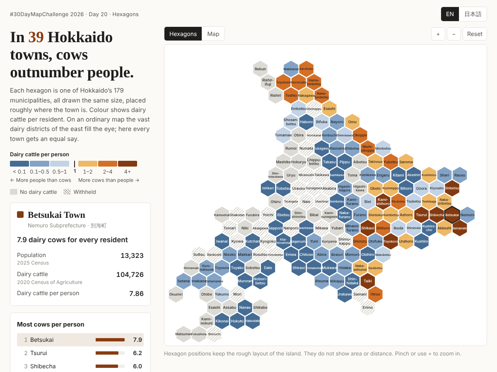

# Where cows outnumber people / 人より牛が多い町

#30DayMapChallenge 2026 Day 20 “Hexagons” (“Hexagons, the good old bestagons.”)

**https://shinyanakashima.github.io/30daymapchallenge-2026day20-cowtown/**



Hokkaido’s 179 municipalities drawn as equal-sized hexagons and coloured by dairy cattle per resident. In 39 of them, dairy cattle outnumber people. On an ordinary map the large dairy districts of the east dominate; on the hexagon grid every town has the same weight. The page is in English, with a Japanese switch.

## 作品について

北海道の179市町村を同じ大きさの六角形で並べたグリッド・カルトグラムです。色は「人口1人あたりの乳用牛の頭数」で、1頭を境に、人の方が多い町を青系、牛の方が多い町を橙系で塗り分けています。普通の地図では面積の広い酪農の町ばかりが目立ちますが、六角形にするとどの町も同じ大きさで比べられます。

- 見出し：牛の方が人より多い町は **39市町村**
- 六角形をクリック（タップ）すると、町の名前、人口、乳用牛の頭数、1人あたりの頭数を表示
- 「Map / 地図」で同じ値を市町村の形で表示し、六角形と比べられる
- 1人あたりの頭数の上位10か所と、179市町村すべての一覧
- 英語表示が既定、右上で日本語に切り替え（`?lang=ja` でも指定可）
- スマートフォンでは縦に並び、ピンチ操作か「+」で拡大すると町名が読める

### 1人あたりの乳用牛が多い町（上位10）

| 市町村 | 英語表記 | 人口（2025年） | 乳用牛（2020年） | 1人あたり |
|---|---|---:|---:|---:|
| 別海町 | Betsukai | 13,323 | 104,726 | 7.86 |
| 鶴居村 | Tsurui | 2,400 | 14,917 | 6.22 |
| 標茶町 | Shibecha | 6,517 | 39,231 | 6.02 |
| 上士幌町 | Kamishihoro | 4,472 | 23,685 | 5.30 |
| 豊頃町 | Toyokoro | 2,704 | 12,988 | 4.80 |
| 標津町 | Shibetsu | 4,612 | 21,693 | 4.70 |
| 大樹町 | Taiki | 5,127 | 24,045 | 4.69 |
| 浜中町 | Hamanaka | 5,144 | 22,919 | 4.46 |
| 鹿追町 | Shikaoi | 4,861 | 20,760 | 4.27 |
| 豊富町 | Toyotomi | 3,431 | 13,227 | 3.86 |

## データの出典と年

取得日はいずれも 2026年11月13日です。

| データ | 出典 | 調査・時点 |
|---|---|---|
| 乳用牛の頭数 | 農林水産省 北海道農政事務所「畜産」統計表 [18-01 販売目的で乳用牛を飼養している農業経営体数、飼養頭数（市町村別）](https://www.maff.go.jp/hokkaido/toukei/kikaku/database/tikusan/tikusan.html)（`tikusan-22.xls`、シート「R2」） | **2020年農林業センサス**（2020年2月1日現在）。同ページで市町村別の頭数が載っている最新の年がこの年です。値は「販売目的で乳用牛を飼養している農業経営体」の飼養頭数で、畜産統計の値ではありません。 |
| 人口 | 総務省統計局「[令和7年国勢調査 人口速報集計](https://www.e-stat.go.jp/stat-search/files?page=1&layout=datalist&lid=000001482693)」第1表（e-Stat、2026年5月29日公表） | **2025年国勢調査 人口速報集計**（2025年10月1日現在） |
| 市町村の境界と位置 | 国土交通省「[国土数値情報（行政区域データ）N03](https://nlftp.mlit.go.jp/ksj/gml/datalist/KsjTmplt-N03-2026.html)」北海道 | 2026年版（2026年1月1日時点） |
| 市町村の英語表記 | [Wikidata](https://www.wikidata.org/)（地方公共団体コード P429 で照合、CC0） | 取得時点 |

「国土数値情報（行政区域データ）」（国土交通省）を加工して作成しています。

## 注記

- **調査の年が違う**：乳用牛の頭数は2020年（農林業センサス、2月1日現在）、人口は2025年（国勢調査 人口速報集計、10月1日現在）です。
- **秘匿の町**：統計表で数字が「x」（秘匿）になっている28市町村は、推測で埋めず、画面では斜線で「Withheld / 秘匿」として示しています。1人あたりの頭数は計算せず、見出しの39にも含めていません。秘匿の町のなかにも、実際には牛の方が多い町がある可能性があります。
  - 赤平市、三笠市、滝川市、砂川市、歌志内市、知内町、森町、寿都町、蘭越町、留寿都村、喜茂別町、京極町、共和町、泊村、積丹町、余市町、赤井川村、南幌町、奈井江町、月形町、浦臼町、妹背牛町、沼田町、占冠村、音威子府村、幌加内町、様似町、えりも町
- 統計表で「-」の町（32市町村）は、販売目的で乳用牛を飼う経営体が無いものとして0頭とし、灰色で示しています。
- **六角形の配置**は町どうしのおおよその位置関係を保ったもので、面積や距離は表していません。
- 札幌市は10区を1つにまとめています。
- 北方領土の6村（色丹村、泊村、留夜別村、留別村、紗那村、蘂取村）は統計の対象外のため、六角形の配置から外しています。地図表示では灰色の点線で輪郭だけを示しています。
- 見出しの “towns” は市・町・村すべてを指します。

## 六角形の配置の作り方

`scripts/build.py`（`scripts/hexgrid.py`）で作っています。

1. N03 の境界を市町村ごとにまとめ（札幌市は区を統合、北方領土の6村を除外）、北海道中心のランベルト正積方位図法（中心 北緯43.5度・東経142.8度）に投影して、各市町村の重心を求めます。
2. 頂点が上を向いた六角形の格子（奇数行を半セル右にずらす “odd-r” 方式、行0が北端）を地図に重ね、陸地から 0.7 セル以内に中心がある格子を候補にします。
3. 重心と格子の中心の**距離の二乗の合計が最小**になるように、179市町村を候補の格子に1対1で割り当てます（ハンガリアン法、`scipy.optimize.linear_sum_assignment`）。
4. 格子の大きさ（六角形の外接円半径）と格子の原点のずらし方を変えて試し、実際に境界を接する市町村どうしが六角形でも隣り合う割合が高く、内側に穴ができない組み合わせを選びました。採用した値は半径 14.5 km、原点のずらし (0.75 セル, 0.67 行) です。実際に隣接する市町村の組の約67%が六角形でも隣り合い、約93%が2セル以内に入っています。
5. 割り当てのあと、どの町とも接していなかった4町を手で動かしました。

### 手で整えた点

| 市町村 | 整えた内容 |
|---|---|
| 松前町 | 南西端で孤立していたため、福島町の隣へ |
| 苫前町 | 留萌沿岸から離れて孤立していたため、初山別村・小平町・留萌市に接する位置へ |
| 根室市 | 東端で孤立していたため、別海町の東、浜中町の北東へ |
| 羅臼町 | 斜里町だけに接していたため、斜里町と標津町の両方に接する位置へ |

奥尻町は島のため、せたな町に接する位置のままにしています。

### 配置データ（CC0）

完成した配置は次のファイルで公開しています。**配置（市町村コード、名前、格子の行・列、六角形の形）は [CC0 1.0](https://creativecommons.org/publicdomain/zero/1.0/) で、自由に使えます。**

- [`data/hex_layout.csv`](data/hex_layout.csv)：`code`（市町村コード5桁）、`name_ja`、`name_en`、`row`、`col`
  - 格子は頂点が上を向いた六角形で、奇数行（row が奇数）を半セル右にずらします（odd-r）。row 0 が北端、col 0 が西端です。
- [`data/hex_layout.geojson`](data/hex_layout.geojson)：同じ配置を六角形のポリゴン（経緯度、EPSG:4326）にしたもの。北海道の上に重なる位置に置いていますが、形と位置はおおよそです。

統計を結合したものは [`data/dairy_cattle_per_person.csv`](data/dairy_cattle_per_person.csv) です（`cattle_status` は `value` / `zero` / `withheld`）。このファイルの元の統計の利用条件は各出典に従います。

## 再現手順

Python 3.11 以上と Node.js（表示確認のみ）を使います。

```bash
pip install -r requirements.txt
```

```bash
bash scripts/fetch_data.sh
```

```bash
python3 scripts/build.py
```

`data/` と `web/data/` が作り直されます。ページは `web/` を静的に配信すれば表示できます。

```bash
python3 -m http.server 8765 --directory web
```

表示の確認（コンソールエラーと 404 が無いこと、`docs/screenshot.png` の作成）には Playwright を使います。

```bash
node scripts/check_page.js http://localhost:8765/ docs
```

GitHub Pages へは `main` への push で `.github/workflows/pages.yml` がデプロイします（`web/` に `docs/screenshot.png` と配置データを加えて公開）。

## 構成

```
scripts/fetch_data.sh   元データの取得
scripts/load.py         元データの読み込みと結合
scripts/hexgrid.py      六角形の格子と割り当て
scripts/build.py        配置の作成、データの書き出し
scripts/check_page.js   Playwright による表示確認とスクリーンショット
web/                    公開するページ（D3.js）
data/                   配置データと結合した統計
docs/screenshot.png     スクリーンショット（1200×900）
```

## ライセンス

コードは [MIT License](LICENSE)。六角形の配置データ（`data/hex_layout.csv`、`data/hex_layout.geojson`）は CC0 1.0。統計と境界のデータは各出典の利用条件に従います。
